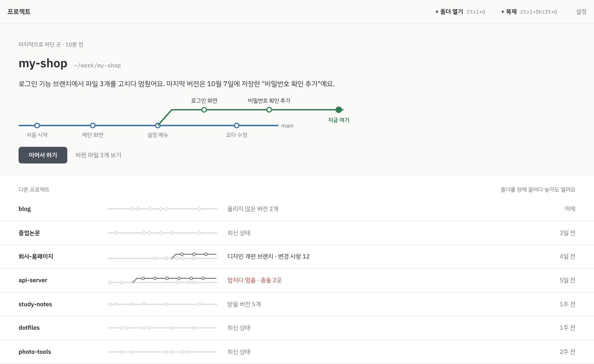
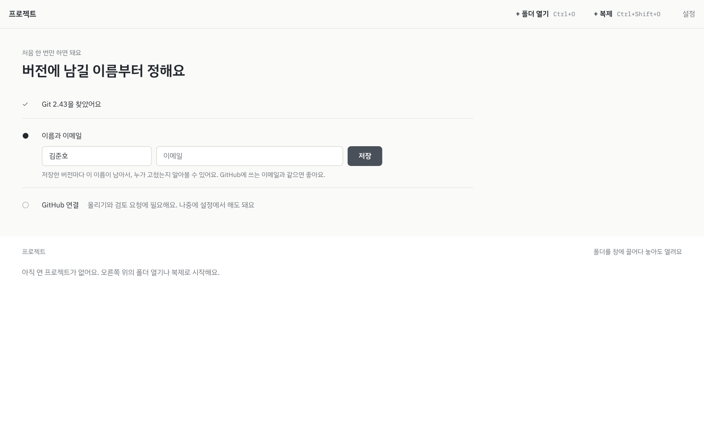

# 시작 화면 디자인

- 날짜: 2026-10-15
- 상태: 조사 결과. 채택하면 `docs/decision.md`에 결정으로 올리고 `docs/spec.md`의 "홈" 화면 설명에 반영한다.
- 앞선 문서: `design-direction.md`의 먹색 모노 색, 문구 규칙과 `terminology.md`의 용어를 따른다.
- 그림: `img/start-normal.png`, `img/start-first.png`, 다크 모드는 `-dark`. 제목 바는 OS 기본이라 그림에서 뺐다.

## 방향
다른 Git 앱의 "최근 저장소 목록"을 따르지 않고 hiGit의 특징에서 출발했다. 노선도, 버전, 상태를 문장으로 말하는 쉬운 말이다.
참고한 것: 영상·음악 앱의 "이어서 보기", 게임의 "이어하기", 할 일 앱 Things의 "오늘" 목록.
대부분은 어제 하던 프로젝트를 이어서 하려고 앱을 켠다. 그래서 마지막 프로젝트를 크게 보여주고 버튼 하나로 이어서 하게 한다.

## 평소 화면
위에서 아래로 세 부분이다.

1. 상단 바: 왼쪽 "프로젝트", 오른쪽 "+ 폴더 열기 Ctrl+O", "+ 복제 Ctrl+Shift+O", "설정". 폴더 열기와 복제는 버튼이 아니라 굵은 글자와 단축키로 둔다. 복제 단축키는 제안이다.
2. 마지막으로 하던 곳: 바탕 `bg` 위에
   - 작은 글자 "마지막으로 하던 곳 · 10분 전"
   - 프로젝트 이름 26px과 경로
   - 상태 문장. 예: 로그인 기능 브랜치에서 파일 3개를 고치다 멈췄어요. 마지막 버전은 10월 7일에 저장한 "비밀번호 확인 추가"예요.
   - 그 프로젝트의 노선도. 최근 버전 몇 개와 "지금 여기"
   - 주 버튼 "이어서 하기", 옆에 글자 "바뀐 파일 3개 보기"
3. 다른 프로젝트: 줄마다 이름, 작은 노선도, 상태, 마지막으로 연 때. 머리 오른쪽에 "폴더를 창에 끌어다 놓아도 열려요".

## 색
먹색 모노 토큰을 그대로 쓰고, 색이 들어가는 곳을 둘로 줄인다.
- 위쪽 큰 노선도만 브랜치 색. 이어서 할 곳이라 눈이 먼저 가야 한다.
- 아래 작은 노선도는 회색 `border-strong`, 갈라진 브랜치만 `muted`로 조금 진하게.
- 상태 글자는 본문색. 충돌만 `deleted` 빨강.

## 처음 실행
마법사 화면 대신 "마지막으로 하던 곳" 자리에 설정을 둔다.
- 작은 글자 "처음 한 번만 하면 돼요", 제목 "버전에 남길 이름부터 정해요"
- ✓ Git 2.43을 찾았어요
- ● 이름과 이메일 입력, 주 버튼 "저장". 둘째 줄: 저장한 버전마다 이 이름이 남아서, 누가 고쳤는지 알아볼 수 있어요. GitHub에 쓰는 이메일과 같으면 좋아요.
- ○ GitHub 연결. 올리기와 검토 요청에 필요하고, 나중에 설정에서 해도 된다.
- 아래 프로젝트 자리: "아직 연 프로젝트가 없어요. 오른쪽 위의 폴더 열기나 복제로 시작해요."

이름과 이메일을 저장하면 이 부분이 사라지고, 첫 프로젝트를 열면 평소 화면이 된다.

## 이럴 때
| 이럴 때 | 시작 화면은 |
| --- | --- |
| Git이 없을 때 | 첫 줄이 "Git이 설치되어 있지 않아요". Windows는 내려받기 링크, Ubuntu는 설치 명령과 복사 버튼, 그리고 "다시 확인" |
| 버전 관리를 하지 않는 폴더를 열 때 | 작업 공간 위에 "이 폴더는 아직 버전 관리를 하지 않아요"와 "버전 관리 시작". 둘째 줄에 파일은 그대로 두고 기록만 시작한다고 적음 |
| 목록의 폴더가 사라졌을 때 | 줄을 흐리게 남기고 "목록에서 빼기" |
| 마지막 프로젝트 폴더가 사라졌을 때 | "마지막으로 하던 곳" 대신 그다음 프로젝트를 보여줌 |
| 이메일이 GitHub와 다를 때 | GitHub 연결 뒤 한 번만 "GitHub 이메일로 바꿀까요?" |

## 언제 보이나
앱을 다시 켜면 마지막 프로젝트를 바로 연다. 시작 화면은 작업 공간 상단 바의 프로젝트 메뉴에서 "다른 프로젝트 열기"로 온다. 탐색기나 파일 관리자에서 우클릭으로 열 때도 건너뛴다.

## 구현 메모
- 상태 문장과 작은 노선도는 프로젝트마다 git을 읽어야 한다. 목록은 먼저 이름과 시간만 그리고, 상태와 노선도는 Query로 나중에 채운다.
- 작은 노선도는 최근 버전 열 개 정도와 갈라진 브랜치 하나만 그린다. 버전 기록 화면의 노선도 그리기 코드를 축소해서 같이 쓴다.
